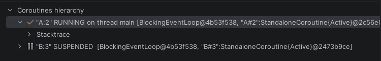

# Mobile application development - Coroutines (seminar 12.1)

### Task - 1

If `println("All launched")` is moved after closing brackets it will be printed at the end because coroutineScope starts
suspending block and waits until the block and any coroutines launched in it is complete.

### Task - 3

When coroutineScope is removed error `Unresolved reference 'launchTicker'.` is shown

### Task - 6

All prints in job is worked because there is no check for activeness of them. That's why when we use delay or add
ensureActive program behaves as expected, because both delay and ensureActive adds the check.

### Task - 8

draft saved is not printed because as mentioned in Task - 6 delay checks the activeness of the job. So once delay(100)
is run it knows that this job is cancelled and leaves the finally block, even though first CancellationException
couldn't stop finally block from running.

### Task - 9

When we use LAZY start for async it will be executed only when it is called with await. So if we call each result one by
one it will take around 1500 ms to execute all of them. However, if we use awaitAll it will still give around 500 ms
because all async blocks are called at once

### Task - 11

`Module with the Main dispatcher is missing. Add dependency providing the Main dispatcher, e.g. 'kotlinx-coroutines-android' and ensure it has the same version as 'kotlinx-coroutines-core'`
org.jetbrains.kotlinx:kotlinx-coroutines-android is needed on Android studio to solve this error

### Task - 12

| Setup | Classification |
|---|---|
| `runBlocking` + `delay` | Concurrency, not parallelism |
| `runBlocking` + `Thread.sleep` | Sequential execution |
| `Dispatchers.Default` + `Thread.sleep` | Parallelism, when multiple worker threads are available |
| Single thread + `Thread.sleep` | Sequential execution |

### Task - 14

B's line number in Coroutines tab: 19
